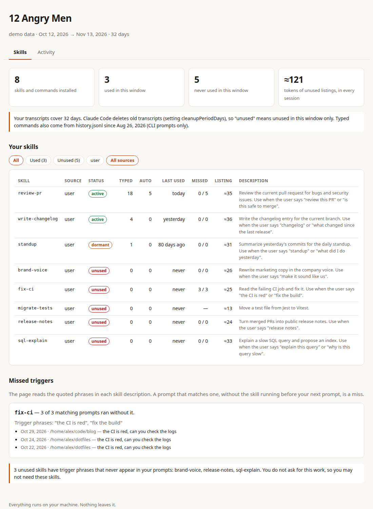

# 12 Angry Men

See which of your Claude Code skills you really use, and which ones never start when they should.



12 Angry Men reads your local Claude Code files (`~/.claude`). It shows a page with two tabs:

- **Skills**: every skill and command you have installed. How often you typed it, how often Claude called it, when you last used it, and how many tokens its listing costs in every session.
- **Missed triggers**: prompts that match a trigger phrase of a skill, but the skill did not run.
- **Activity**: prompts per day, when you work, your projects, the tools Claude calls, and token usage per model.

Everything runs on your machine. The server listens on `127.0.0.1` only. No data leaves your computer. No LLM is called.

## Run

Requires Node.js 22 or later. There are no runtime dependencies.

```sh
npx 12-angry-men          # your data
npx 12-angry-men --demo   # generated fake data, your files are not read
```

From a clone:

```sh
pnpm install
pnpm start                # or: pnpm demo
```

Options:

```
--port <number>   Local port. Default: 4512.
--dir <path>      Claude Code folder. Default: ~/.claude.
--demo            Show generated fake data. Cannot be used with --dir.
--no-open         Do not open the browser.
```

## How it counts

- **Your prompts**: only messages you typed. Tool results, system messages and prompts sent by automation through the SDK do not count. Sessions without a typed prompt show as "automated".
- **Typed**: a prompt that starts a skill with `/name`.
- **Auto**: Claude called the skill on its own (the `Skill` tool).
- **Status**: `active` if used in the last 30 days, `dormant` if used before that, `unused` if never used.
- **Listing tokens**: Claude Code puts the name and description of each skill in the context of every session. The page estimates 4 characters per token. Project skills load only in their repo, so the "unused listings" total leaves them out.
- **Missed triggers**: the page reads the quoted phrases in each skill description, for example `Use when the user says "fix the build"`. A prompt that matches a phrase, without the skill running before your next prompt, is a miss. `XXXX` and digit runs in a phrase match any id. A one-word phrase matches only at the start of a prompt.
- **Corrections**: prompts that start with "no", "wrong", "I said", "still doesn't work" and similar, in English and French. This is a heuristic.
- **Active time**: the sum of gaps between messages. A gap over 15 minutes counts as a break.

## Sources

| File | What it gives |
|---|---|
| `projects/*/*.jsonl` | Sessions, prompts, tool calls, token usage |
| `projects/*/*/subagents/*.jsonl` | Subagent runs (tokens and tools only) |
| `history.jsonl` | Commands typed in the CLI, kept longer than transcripts. Entries of a session with a transcript are skipped, so nothing counts twice. |
| `skills/`, `commands/` | Your skills and commands |
| `skills/synced/` | Skills synced from claude.ai (`anthropic-skills:name`) |
| `plugins/installed_plugins.json`, `plugins/synced/` | Plugin skills (`plugin:name`) |
| `<repo>/.claude/skills/` | Project skills, for every repo seen in your transcripts |

## Limits

- Claude Code deletes old transcripts (setting `cleanupPeriodDays`). The page only sees what is still on disk. "Unused" means unused in that window.
- `history.jsonl` holds CLI prompts only. Prompts typed in an IDE extension are not in it.
- A skill that lives only in the cloud shows under "Invoked, but not found on disk".
- The transcript format is not a public API. A Claude Code update can break the parser. Problems show at the bottom of the page.

## Development

```sh
pnpm check   # type check (src and test)
pnpm test    # node:test, no extra dependency
pnpm build   # compile to dist/ for npm
```


## Roadmap

- Find what you do again and again, and propose a skill built from your real sessions, with the sessions as proof.

## License

MIT
